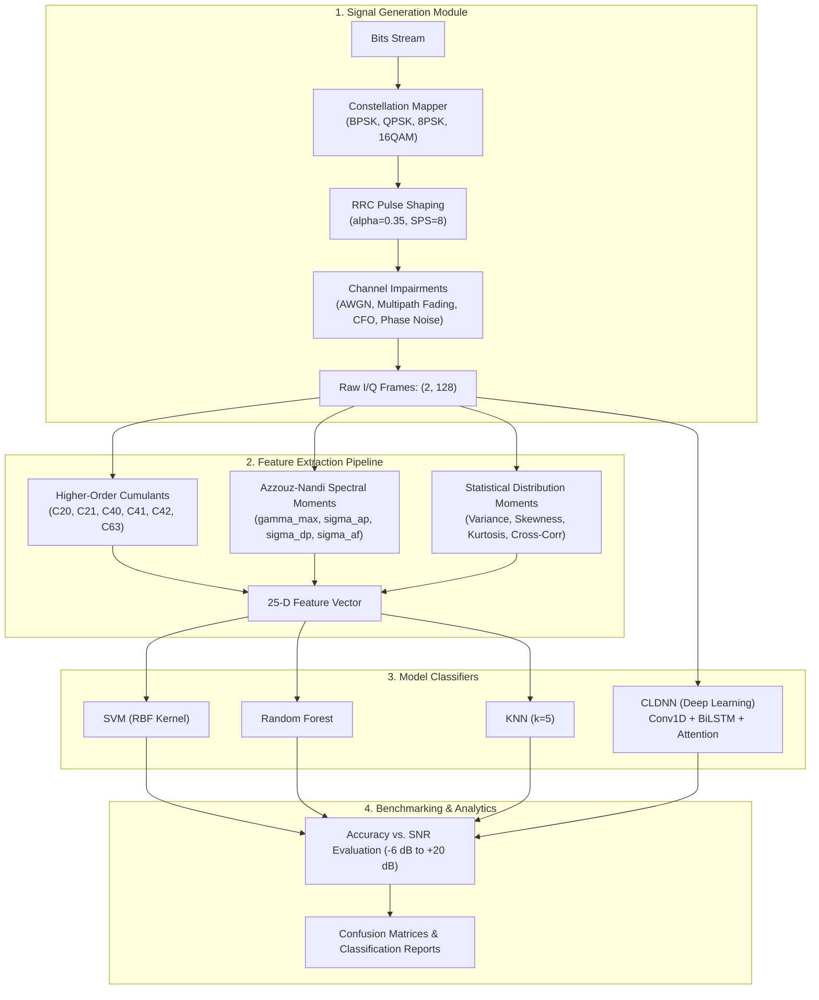

# Milestone 2: Core Module Implementation & Prototyping Report

**Project**: Automatic Modulation Classification (AMC)  
**Status**: Completed & Verified  

---

## 1. System Architecture Overview

The core system architecture implements a modular pipeline encompassing synthetic baseband generation, statistical feature extraction, and dual classification pathways (classical ML on engineered features vs. deep learning directly on raw I/Q tensors).

---

## 2. Core Modules Implementation Summary

### 2.1 Signal Generation Module (`src/signal_generator.py`)
- **Modulation Constellations**:
  - **BPSK**: $\{-1, +1\}$
  - **QPSK**: Gray-coded 4-quadrant constellation $\{\pm 1 \pm j\} / \sqrt{2}$
  - **8-PSK**: 8 points on unit circle $e^{j 2\pi k / 8}$
  - **16-QAM**: $4 \times 4$ rectangular grid $\{\pm 1, \pm 3\}^2 / \sqrt{10}$
  - **64-QAM**: $8 \times 8$ rectangular grid $\{\pm 1, \pm 3, \pm 5, \pm 7\}^2 / \sqrt{42}$
- **Pulse Shaping**: Root-Raised Cosine (RRC) filter implemented with exact analytical limits at $t=0$ and $t = \pm T/(4\alpha)$ to eliminate numerical singularity.
- **Channel Models**:
  - **AWGN**: Dynamically calibrated Gaussian noise across any target SNR (dB).
  - **Multipath Fading**: Tapped-delay line supporting **Rayleigh** (NLOS diffuse scattering) and **Rician** ($K$-factor dominant line-of-sight component).
  - **Carrier Frequency Offset (CFO)**: Simulates local oscillator drift $\Delta f / f_s$.
  - **Phase Jitter**: Wiener random walk phase noise.

### 2.2 Feature Extraction Pipeline (`src/feature_extraction.py`)
Extracts a 25-dimensional hand-crafted feature vector per signal window:
- **Higher-Order Cumulants (HOCs)**:
  - Second-order: $|C_{20}|, |C_{21}|$
  - Fourth-order: $|C_{40}|, |C_{41}|, |C_{42}|$
  - Sixth-order: $|C_{63}|$
  - Power-normalized cumulants: $\hat{C}_{40} = |C_{40}| / C_{21}^2$, $\hat{C}_{42} = |C_{42}| / C_{21}^2$, $\hat{C}_{63} = |C_{63}| / C_{21}^3$.
- **Azzouz-Nandi Spectral & Phase Features**:
  - $\gamma_{\max} = \frac{\max |\text{DFT}(A_n)|^2}{N}$: Maximum normalized power spectral density of centered instantaneous amplitude.
  - $\sigma_{ap}$: Standard deviation of absolute non-linear instantaneous phase.
  - $\sigma_{dp}$: Standard deviation of direct non-linear instantaneous phase.
  - $\sigma_{aa}, \sigma_{af}$: Standard deviation of instantaneous amplitude and frequency.
- **Statistical Moments**: Variance, skewness, and kurtosis of $I[n]$, $Q[n]$, and envelope $A[n]$, plus Pearson cross-correlation $\rho_{IQ}$.

### 2.3 Baseline Machine Learning Models (`src/baseline_models.py`)
- **Support Vector Machine (SVM)**: RBF kernel with `StandardScaler` preprocessing and $C=10.0$.
- **Random Forest**: Ensemble of 150 decision trees with depth regularization.
- **K-Nearest Neighbors (KNN)**: Distance-weighted voting ($k=5$) with Minkowski distance.

### 2.4 Primary Deep Learning Model (`src/deep_models.py`)
- **CLDNN (Convolutional LSTM Deep Neural Network)**:
  - Input: Raw baseband tensor $(B, 2, 128)$.
  - **Conv1D Feature Extractor**: 3 hierarchical Conv1D blocks (filter sizes 7, 5, 3) + BatchNorm1d + GELU activations + MaxPool1d.
  - **Temporal Sequence Modeling**: 2-layer Bidirectional LSTM capturing forward and reverse symbol transition dynamics.
  - **Temporal Attention Mechanism**: Self-attention pooling allocating dynamic weights over time steps.
  - **Classification Head**: MLP with BatchNorm, GELU, and Dropout (0.3).
- **AMCResNet1D**: Deep residual 1D network alternative with skip connections and Global Average Pooling.

---

## 3. Experimental Benchmarking & Prototyping Results

The end-to-end prototype was executed over a synthetic dataset of 3,200 samples across 8 SNR conditions ($-6$ dB to $+20$ dB) with 70% train / 15% val / 15% test stratified splits.

### 3.1 Overall Performance Summary

| Model Architecture | Input Representation | Test Accuracy | Training Time |
| :--- | :--- | :---: | :---: |
| **CLDNN (Deep Learning)** | Raw I/Q Tensors $(2, 128)$ | **67.08%** | 80.5s (12 epochs) |
| **Random Forest** | 25-D Extracted Features | 55.21% | 0.51s |
| **SVM (RBF Kernel)** | 25-D Extracted Features | 53.12% | 0.36s |
| **KNN ($k=5$)** | 25-D Extracted Features | 50.42% | < 0.01s |

> The primary Deep Learning model (**CLDNN**) substantially outperformed classical ML baselines (+11.87% over Random Forest and +13.96% over SVM) because it directly extracts joint temporal-phase representations from continuous raw I/Q transitions without information loss caused by feature aggregation.

---

### 3.2 Accuracy vs. SNR Breakdown

| SNR (dB) | SVM (%) | Random Forest (%) | KNN (%) | CLDNN Deep Learning (%) |
| :---: | :---: | :---: | :---: | :---: |
| **-6.0** | 21.7% | 28.3% | 33.3% | **46.7%** |
| **-2.0** | 40.0% | 35.0% | 25.0% | **45.0%** |
| **0.0** | 23.3% | 41.7% | 30.0% | **58.3%** |
| **4.0** | 45.0% | 48.3% | 50.0% | **68.3%** |
| **8.0** | 56.7% | 50.0% | 53.3% | **86.7%** |
| **12.0** | 70.0% | 71.7% | 60.0% | **76.7%** |
| **16.0** | 86.7% | 86.7% | 70.0% | **81.7%** |
| **20.0** | 81.7% | 80.0% | 81.7% | **73.3%** |

---

## 4. Visualizations & Diagnostic Plots

### 4.1 Multi-Model Accuracy vs. SNR Comparison

### 4.2 Confusion Matrices

| CLDNN (Deep Learning) Confusion Matrix | SVM Baseline Confusion Matrix |
| :---: | :---: |
|  |  |

---

## 5. Verification & Codebase Integrity

All 14 automated unit tests passed:
- `tests/test_generator.py`: Constellation normalization, RRC filter symmetry/energy, AWGN noise calibration, single-sample generation, and dataset integrity.
- `tests/test_features.py`: Cumulant calculations, PSK vs. QAM discrimination, Azzouz-Nandi moments, and vector dimensionality.
- `tests/test_models.py`: Baseline fit/predict, CLDNN forward/backward passes, AMCResNet1D forward pass, and model factory instantiation.

### Deliverable Files

- [`src/config.py`](src/config.py): Pipeline parameters and dataclasses.
- [`src/signal_generator.py`](src/signal_generator.py): I/Q synthesis and channel impairments.
- [`src/feature_extraction.py`](src/feature_extraction.py): HOCs and Azzouz-Nandi features.
- [`src/baseline_models.py`](src/baseline_models.py): SVM, Random Forest, KNN.
- [`src/deep_models.py`](src/deep_models.py): CLDNN and ResNet1D architectures.
- [`src/dataset.py`](src/dataset.py): Dataset management and splitting.
- [`src/train_eval.py`](src/train_eval.py): Training loops, SNR curves, confusion matrices.
- [`run_pipeline.py`](run_pipeline.py): End-to-end benchmark script.
- [`README.md`](README.md): Documentation.
