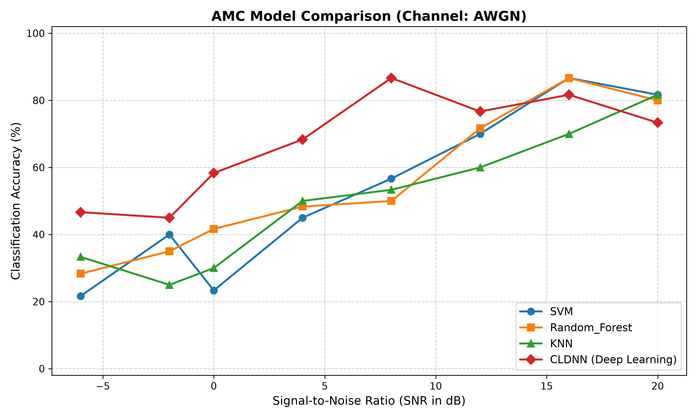
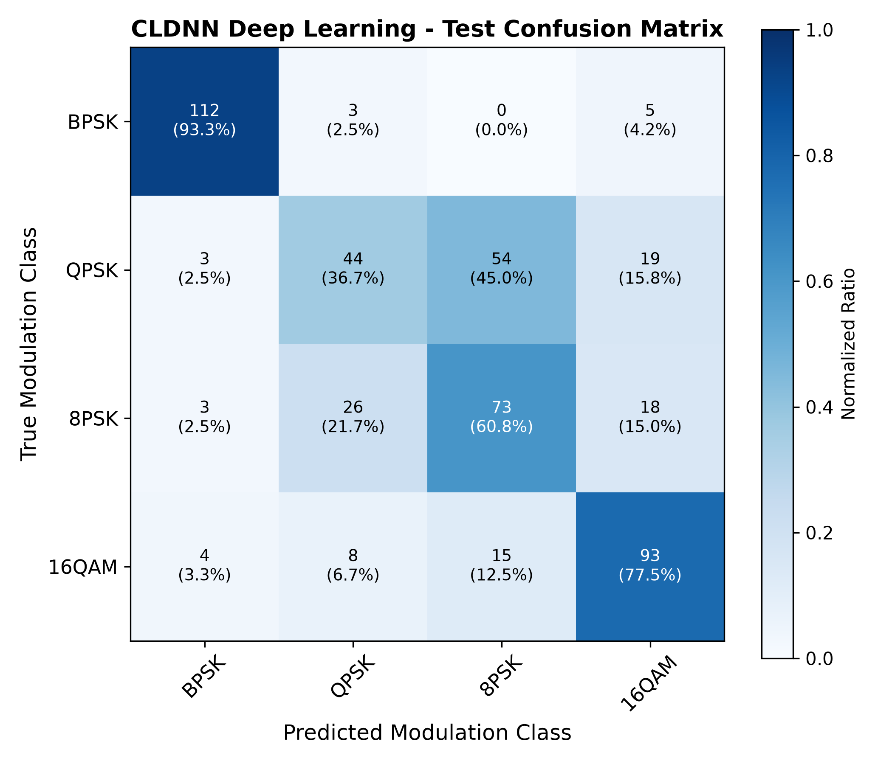
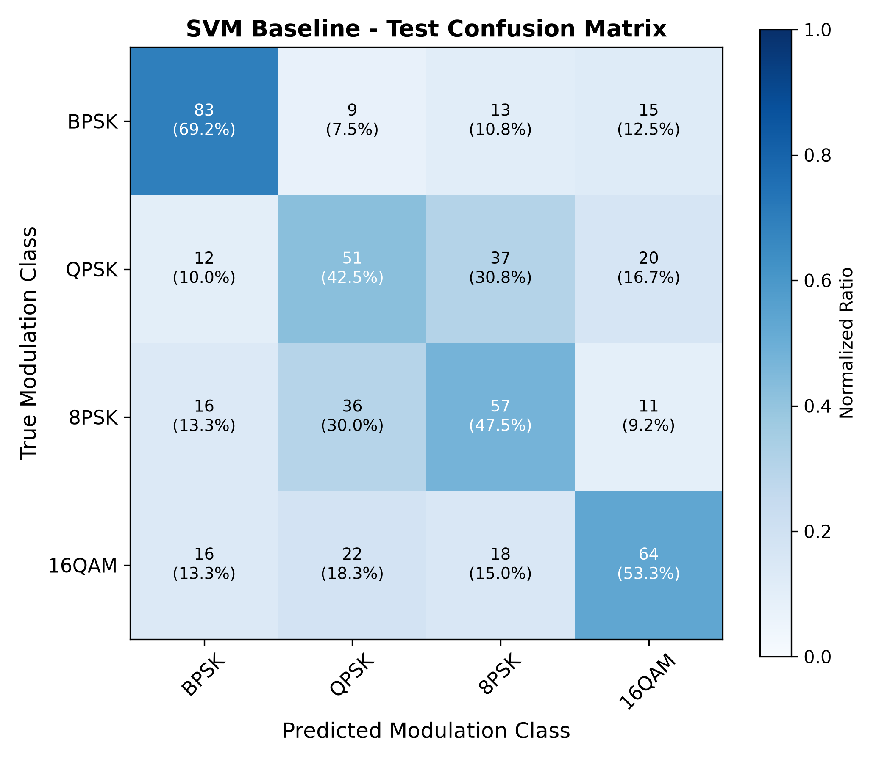

# Automatic Modulation Classification (AMC) - Milestone 2: Core Module Implementation & Prototyping

[](https://www.python.org/)
[](https://pytorch.org/)
[](https://scikit-learn.org/)
[](LICENSE)

An end-to-end framework for **Automatic Modulation Classification (AMC)** in wireless communication systems. It covers baseband synthetic signal generation under diverse channel impairments, domain-expert feature extraction (Higher-Order Cumulants and instantaneous spectral moments), baseline machine learning models (SVM, Random Forest, KNN), and modern Deep Learning architectures (CLDNN with Temporal Attention and ResNet-1D) processing raw I/Q time-series tensors.

---

## 🚀 Key Modules & Architecture

```
modulation-classification/
├── requirements.txt            # Python dependencies (PyTorch, scikit-learn, scipy, etc.)
├── run_pipeline.py             # End-to-end executable benchmarking script
├── README.md                   # Complete architectural documentation
├── Milestone_2_Report.md       # Comprehensive milestone report with benchmark analysis
├── src/
│   ├── __init__.py             # Public API exports
│   ├── config.py               # Signal, channel, experiment, and modulation configurations
│   ├── signal_generator.py     # Baseband I/Q synthesis, RRC pulse shaping & channel impairments
│   ├── feature_extraction.py   # Higher-Order Cumulants (HOCs) & Azzouz-Nandi spectral features
│   ├── baseline_models.py      # SVM, Random Forest, and KNN pipelines with SNR evaluation
│   ├── deep_models.py          # CLDNN (Conv + BiLSTM + Attention) & AMCResNet1D architectures
│   ├── dataset.py              # Stratified train/val/test splits, PyTorch Dataset & DataLoaders
│   └── train_eval.py           # Training loops, SNR curves, confusion matrices, metrics
├── tests/
│   ├── test_generator.py       # Unit tests for constellations, RRC filter, AWGN & SNR
│   ├── test_features.py        # Unit tests for HOCs, Azzouz-Nandi moments, and vector extraction
│   └── test_models.py          # Unit tests for baseline models & PyTorch deep learning models
└── results/                    # Generated datasets, serialized model weights, and performance plots
```

---

## 📡 1. Signal Generation Module (`src/signal_generator.py`)

- **Modulation Schemes Supported**:
  - **BPSK** ($M=2$): Binary Phase Shift Keying.
  - **QPSK** ($M=4$): Quadrature Phase Shift Keying with Gray mapping.
  - **8-PSK** ($M=8$): 8-ary Phase Shift Keying.
  - **16-QAM** ($M=16$): 16-ary Quadrature Amplitude Modulation.
  - **64-QAM** ($M=64$): 64-ary Quadrature Amplitude Modulation.
- **Pulse Shaping**:
  - Root-Raised Cosine (RRC / SRRC) filter with configurable roll-off factor ($\alpha=0.35$), span, and samples-per-symbol ($SPS=8$).
- **Wireless Channel Impairments**:
  - **AWGN**: Signal-to-Noise Ratio (SNR) sweep (e.g. $-6$ dB to $+20$ dB).
  - **Multipath Fading**: Tapped-delay line models supporting **Rayleigh** (diffuse/NLOS) and **Rician** ($K$-factor dominant LOS) channels.
  - **Carrier Frequency Offset (CFO)**: Simulates local oscillator frequency drift $\Delta f / f_s$.
  - **Phase Noise & Jitter**: Simulates phase drift and random phase offset walk.

---

## 🔬 2. Feature Extraction Pipeline (`src/feature_extraction.py`)

Extracts a 25-dimensional domain-expert feature vector from each I/Q sample window:
1. **Higher-Order Statistics & Cumulants (HOCs)** (Swami-Mendel):
   - Second-order: $|C_{20}|, |C_{21}|$
   - Fourth-order: $|C_{40}|, |C_{41}|, |C_{42}|$
   - Sixth-order: $|C_{63}|$
   - Scale-invariant normalized cumulants: $\hat{C}_{40} = |C_{40}|/C_{21}^2$, $\hat{C}_{42} = |C_{42}|/C_{21}^2$, $\hat{C}_{63} = |C_{63}|/C_{21}^3$.
2. **Instantaneous Spectral & Phase Characteristics** (Azzouz & Nandi):
   - $\gamma_{\max}$: Maximum value of the power spectral density of normalized centered instantaneous amplitude.
   - $\sigma_{ap}$: Standard deviation of the absolute value of non-linear instantaneous phase.
   - $\sigma_{dp}$: Standard deviation of direct non-linear instantaneous phase.
   - $\sigma_{aa}$: Standard deviation of centered instantaneous amplitude.
   - $\sigma_{af}$: Standard deviation of centered instantaneous frequency.
3. **Statistical Distribution Moments**:
   - Variance, Skewness, and Kurtosis of In-phase ($I$), Quadrature ($Q$), and Envelope ($A$).
   - $I/Q$ Pearson cross-correlation coefficient ($\rho_{IQ}$).

---

## 🤖 3. Baseline Machine Learning Models (`src/baseline_models.py`)

- **Support Vector Machine (SVM)**:
  - RBF kernel with `StandardScaler` normalization and automated hyperparameter scaling.
- **Random Forest Classifier**:
  - Ensemble of 150 randomized decision trees with maximum depth regularization.
- **K-Nearest Neighbors (KNN)**:
  - Distance-weighted neighbor voting ($k=5$) with Minkowski metric.

---

## 🧠 4. Primary Deep Learning Model (`src/deep_models.py`)

Operates directly on raw baseband I/Q arrays of shape `(Batch, 2, Sequence_Length)`:
- **CLDNN (Convolutional LSTM Deep Neural Network with Temporal Attention)**:
  - **1D Convolutional Front-End**: 3 Conv1D layers (kernels 7, 5, 3) + BatchNorm1d + GELU activations.
  - **Bidirectional LSTM**: 2-layer BiLSTM capturing forward and backward temporal symbol memory.
  - **Temporal Attention Mechanism**: Learnable self-attention pooling allocating dynamic weights over time steps.
  - **Dense Classification Head**: Multi-layer perceptron with Dropout and GELU activations.
- **AMCResNet1D**:
  - Deep 1D Residual Network with skip connections and Global Average Pooling.

---

## 📊 Experimental Results

### Accuracy vs. SNR Benchmark


### Model Performance Comparison

| Model Architecture | Input Representation | Test Accuracy | Training Time |
| :--- | :--- | :---: | :---: |
| **CLDNN (Deep Learning)** | Raw I/Q Tensors $(2, 128)$ | **67.08%** | 80.5s (12 epochs) |
| **Random Forest** | 25-D Extracted Features | 55.21% | 0.51s |
| **SVM (RBF Kernel)** | 25-D Extracted Features | 53.12% | 0.36s |
| **KNN ($k=5$)** | 25-D Extracted Features | 50.42% | < 0.01s |

### Confusion Matrices

| CLDNN (Deep Learning) | SVM Baseline |
| :---: | :---: |
|  |  |

---

## 🛠️ Installation & Usage

```bash
# Clone the repository
git clone https://github.com/Abhinavvdon/modulation-classification.git
cd modulation-classification

# Create and activate virtual environment
python -m venv .venv
.\.venv\Scripts\Activate.ps1  # Windows PowerShell
# source .venv/bin/activate    # Linux / macOS

# Install dependencies
pip install -r requirements.txt
```

### Running Unit Tests

```bash
python -m unittest discover tests
```

### Running the End-to-End Pipeline

```bash
python run_pipeline.py --samples-per-snr 150 --epochs 15 --output-dir results
```
